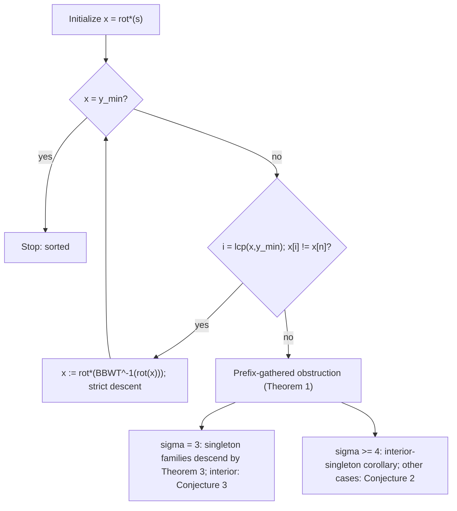

# Singleton Ternary Families and Permutation Groups for BBWT Reachability

**Abstract.**
Badkobeh et al. conjectured that the bijective Burrows–Wheeler transform and cyclic rotation generate a transitive action on every fixed Parikh class. We record a direct corollary of their descent lemma for vectors $(e_1,1,\dots,1,e_\sigma)$, and give additional constructive descent arguments for the ternary families $(1,e_b,e_c)$ and $(e_a,e_b,1)$. Together, these cover every positive ternary vector with a singleton entry. We also prove a dihedral position quotient for $(1,k,1)$ and an equivariant projection that merges the two smallest singleton symbols. Reproducible finite computations classify all $113$ ternary cases of degree at most $500$ and verify a two-step descent property for obstruction necklaces of length at most $13$. We state separate sufficient reductions for general-alphabet reachability and for the remaining ternary interior cases.

**Keywords:** Bijective Burrows–Wheeler Transform, Lyndon factorization, Parikh vector, permutation groups, Schreier graphs, combinatorics on words.

## 1. Introduction

The Burrows–Wheeler transform ($\mathsf{BWT}$) [BurrowsWheeler1994](#ref-BurrowsWheeler1994) is a cornerstone of compressed string indexing and data compression [KempaKociumaka2022](#ref-KempaKociumaka2022). Because the ordinary $\mathsf{BWT}$ maps all cyclic rotations of a string to the same output and is not surjective onto $\Sigma^n$, Gil and Scott [GilScott2012](#ref-GilScott2012) and Kufleitner [Kufleitner2009](#ref-Kufleitner2009) introduced the *bijective Burrows–Wheeler transform* ($\mathsf{BBWT}$), grounded in the Gessel–Reutenauer bijection [GesselReutenauer1993](#ref-GesselReutenauer1993) and the extended BWT ($\omega$-order) of Mantaci et al. [Mantaci2007](#ref-Mantaci2007). Rather than appending an artificial sentinel, $\mathsf{BBWT}$ computes the unique Chen–Fox–Lyndon factorization [ChenFoxLyndon1958](#ref-ChenFoxLyndon1958) of a word and stably sorts all cyclic rotations of its Lyndon factors in infinite periodic ($\omega$-)order. Recent algorithmic work has established linear-time construction and indexing [Bannai2021LinearBBWT](#ref-Bannai2021LinearBBWT), [Bannai2024ConstructionIndexing](#ref-Bannai2024ConstructionIndexing), in-place conversion [Koppl2020InPlaceBBWT](#ref-Koppl2020InPlaceBBWT), space–time trade-offs [KopplI2026Tradeoff](#ref-KopplI2026Tradeoff), and reversal sensitivity [Bannai2026Reversal](#ref-Bannai2026Reversal) for $\mathsf{BBWT}$.

In studying $\mathsf{BBWT}$-based repetitiveness measures, Badkobeh, Bannai, and Köppl [BadkobehBannaiKoppl2024](#ref-BadkobehBannaiKoppl2024) (extended with I in [BadkobehBannaiIKoppl2026](#ref-BadkobehBannaiIKoppl2026)) observed a striking reachability phenomenon separating $\mathsf{BBWT}$ from ordinary $\mathsf{BWT}$. Let $\Sigma = \{a_1 < a_2 < \dots < a_\sigma\}$ be a totally ordered alphabet of size $\sigma \ge 2$, and let $\mathcal{S}(p)$ denote the set of all strings with Parikh vector $p = (c_1, \dots, c_\sigma) \in \mathbb{Z}_{>0}^\sigma$. Since both the cyclic rotation $\rho$ and $\mathsf{BBWT}$ are bijections preserving character multiplicities, they generate a subgroup $G(p) = \langle \mathsf{BBWT}, \rho \rangle \le \mathrm{Sym}(\mathcal{S}(p))$.

**Conjecture 1 (Badkobeh, Bannai, I, Köppl [BadkobehBannaiIKoppl2026](#ref-BadkobehBannaiIKoppl2026), Conjecture 1).**

For every alphabet size $\sigma$ and every Parikh vector $p$, the group $G(p) = \langle \mathsf{BBWT}, \rho \rangle$ acts transitively on $\mathcal{S}(p)$; equivalently, any two strings sharing the same Parikh vector can be transformed into one another by a finite sequence of $\mathsf{BBWT}$ and cyclic rotation operations.

Badkobeh et al. [BadkobehBannaiIKoppl2026](#ref-BadkobehBannaiIKoppl2026) explicitly proved Conjecture 1 for binary alphabets and for all-distinct strings, and reported computational checks for ternary strings of length at most $17$. Their descent lemma also directly implies transitivity for $(e_1,1,\dots,1,e_\sigma)$, including $(k,1,1)$ and $(1,1,k)$; we include that corollary as Theorem 3(a). Their non-reachability examples for the ordinary BWT are $\texttt{aaaabbb}$ versus $\texttt{aaababb}$ and $\texttt{abcd}$ versus $\texttt{acbd}$, with inverse BWT interpreted as returning a conjugacy class. The survey of Bannai, Köppl, and Lipták [BannaiKopplLiptak2025Survey](#ref-BannaiKopplLiptak2025Survey), Section 5.5, records the reachability conjecture and its binary and all-distinct cases.

**Contributions and relation to earlier work.**

The main additional descent constructions are the minimal- and maximal-singleton ternary arguments. We separate these from consequences of the earlier descent lemma. Within the primary sources cited here, we have not found explicit proofs of these additional constructions or the two structural projections; this is a bounded literature assessment rather than a certification of priority.

1. **Reductions and exact identities.** Theorem 1 organizes consequences of the earlier descent lemma into a prefix-gathering reduction. Theorem 2 gives a sentinel-BWT embedding, exact inner-BBWT simulation, and a four-run identity.
2. **Ternary singleton families.** Theorem 3(a) records the direct interior-singleton corollary of the earlier lemma. Parts (b) and (c) supply further descent constructions for $(1,e_b,e_c)$ and $(e_a,e_b,1)$. Together these cover $\min(e_a,e_b,e_c)=1$.
3. **Structural projections and finite groups.** Theorem 4 proves a dihedral position quotient for $(1,k,1)$ and a smallest-singleton merge projection. Exact finite computations classify all $113$ positive ternary vectors of degree at most $500$, with replayable certificates for the $74$ primitive cases.
4. **Reproducible bounded evidence and open reductions.** Section 6 reports independently reproducible tests, including all $4{,}017$ obstruction necklaces of length at most $13$, and distinguishes Parikh-class counting statistics from completed orbit searches. Section 7 gives separate sufficient conditions for arbitrary-alphabet and ternary reachability.

**Table 1.** Established cases and their proof provenance.

| Family | Alphabet | Status |
| --- | --- | --- |
| Binary $(e_1,e_2)$ | $\sigma=2$ | Earlier Theorem 5 [BadkobehBannaiIKoppl2026](#ref-BadkobehBannaiIKoppl2026) |
| All-distinct $(1,\dots,1)$ | All | Earlier Theorem 5 [BadkobehBannaiIKoppl2026](#ref-BadkobehBannaiIKoppl2026) |
| Interior singletons $(e_1,1,\dots,1,e_\sigma)$ | All $\sigma\ge3$ | Direct corollary of earlier Lemma 4; Theorem 3(a) here |
| Minimal singleton $(1,e_b,e_c)$ | $\sigma=3$ | Constructive descent, Theorem 3(b) |
| Maximal singleton $(e_a,e_b,1)$ | $\sigma=3$ | Constructive descent, Theorem 3(c) |
| Interior $e_a,e_b,e_c\ge2$ | $\sigma=3$ | Unresolved in general; bounded evidence in Section 6 |

## 2. Preliminaries and Notation

Let $\Sigma = \{a_1 < a_2 < \dots < a_\sigma\}$ be a totally ordered alphabet with $\sigma \ge 2$; for $\sigma = 3$, we write $\Sigma = \{a < b < c\}$ and $p = (e_a, e_b, e_c)$. Throughout the paper we use **1-based indexing**: for a string $s$ of length $n = |s|$, $s[i]$ denotes its $i$-th character ($1 \le i \le n$), and $s[i..j] = s[i]\cdots s[j]$ (with $s[i..j] = \varepsilon$ if $i > j$). For a Parikh vector $p = (c_1, \dots, c_\sigma) \in \mathbb{Z}_{>0}^\sigma$ summing to $n$, $\mathcal{S}(p)$ is the set of all strings over $\Sigma$ containing $c_i$ copies of $a_i$, of cardinality $N = |\mathcal{S}(p)| = n! / \prod_{i=1}^\sigma c_i!$, with lexicographically smallest element $y_{\min} = a_1^{c_1} \cdots a_\sigma^{c_\sigma}$.

For distinct equal-length words, $\mathrm{lcp}(x,y)$ denotes the *length* of their longest common prefix. Thus $x[i]$ is the last matching symbol when $i=\mathrm{lcp}(x,y)\ge1$, and the first mismatch is at $i+1$. All integer intervals with lower endpoint greater than upper endpoint are empty. Positions in the accompanying code and state labels in its certificates are zero-based.

We denote the left cyclic rotation by $\rho(s[1..n]) = s[2..n]s[1]$ and the right cyclic rotation by $\mathsf{rot}(s[1..n]) = \rho^{-1}(s) = s[n]s[1..n-1]$. Two strings are *conjugates* if one is $\rho^r(s)$ for some $r \in \mathbb{Z}$, and $\mathsf{rot}^*(s)$ denotes the lexicographically smallest conjugate of $s$ (its *necklace representative*).

A nonempty word $w \in \Sigma^+$ is *primitive* if $w = u^k$ implies $k = 1$, and a *Lyndon word* [Lyndon1954](#ref-Lyndon1954) if it is strictly lexicographically smaller than all of its proper nonempty suffixes (equivalently, primitive and strictly smaller than all its nontrivial conjugates). By the Chen–Fox–Lyndon (CFL) theorem [ChenFoxLyndon1958](#ref-ChenFoxLyndon1958), every $s \in \Sigma^+$ factors uniquely as $s = L_1 L_2 \cdots L_k$, where each $L_i$ is a Lyndon word and $L_1 \ge_{\mathrm{lex}} L_2 \ge_{\mathrm{lex}} \cdots \ge_{\mathrm{lex}} L_k$, computable in $O(n)$ time via Duval's algorithm [Duval1983](#ref-Duval1983).

For nonempty words $u, v \in \Sigma^+$, let $u^\omega = uuu\cdots$ be the infinite periodic repetition of $u$. The *$\omega$-order* [Mantaci2007](#ref-Mantaci2007) is defined by $u <_\omega v \iff u^\omega <_{\mathrm{lex}} v^\omega$.

**Lemma 1 ($\omega$-Order Equivalence).**

Let $u, v \in \Sigma^+$ be nonempty primitive strings with $u^\omega \neq v^\omega$. Then:

- **(i)** $u <_\omega v \iff uv <_{\mathrm{lex}} vu$, and if $|u| = |v|$, then $u <_\omega v \iff u <_{\mathrm{lex}} v$.
- **(ii)** If $u$ and $v$ are Lyndon words, then $u <_\omega v \iff u <_{\mathrm{lex}} v$.

*Proof.*
For (i), let $p = |u|$ and $q = |v|$. By the Fine–Wilf theorem [FineWilf1965](#ref-FineWilf1965), since $u^\omega \neq v^\omega$, the smallest 1-based index $t \ge 1$ at which $u^\omega[t] \neq v^\omega[t]$ satisfies $t \le p + q - \gcd(p, q) < p + q$. Consider any $1 \le s \le t$. If $s \le p$, then $(uv)[s] = u[s] = u^\omega[s]$. If $p < s \le t$, then $1 \le s - p < s \le t$ and $s - p \le q$ (because $s < p + q$), so by minimality of $t$ we have $(uv)[s] = v[s - p] = v^\omega[s - p] = u^\omega[s - p] = u^\omega[s]$. Symmetrically, $(vu)[s] = v^\omega[s]$ for every $1 \le s \le t$. Hence $(uv)[1..t-1] = (vu)[1..t-1]$, $(uv)[t] = u^\omega[t]$, and $(vu)[t] = v^\omega[t]$, proving $u^\omega <_{\mathrm{lex}} v^\omega \iff uv <_{\mathrm{lex}} vu$. When $|u| = |v|$, comparing $uv$ and $vu$ terminates within the first $|u|$ positions, giving $u <_{\mathrm{lex}} v$.

For (ii), if neither $u$ nor $v$ is a prefix of the other, their first mismatch lies within $\min(|u|,|v|)$, so $u <_\omega v \iff u <_{\mathrm{lex}} v$. Suppose $u$ is a proper prefix of $v$. Then $u <_{\mathrm{lex}} v$, and we may write $v = u^m w$ with $m \ge 1$, $w \neq \varepsilon$, and $u$ not a prefix of $w$. Because $v$ is a Lyndon word, its proper suffix $w$ satisfies $w >_{\mathrm{lex}} v >_{\mathrm{lex}} u$. Moreover, $w$ cannot be a prefix of $u$, as $u = w z$ ($z \neq \varepsilon$) would yield $w <_{\mathrm{lex}} u$. Thus $u$ and $w$ disagree within $\min(|u|,|w|)$ positions with $u <_{\mathrm{lex}} w$, whence $u^\omega = u^m u^\omega <_{\mathrm{lex}} u^m w v^\omega = v^\omega$, i.e., $u <_\omega v$. By symmetry, if $v$ is a proper prefix of $u$, then $v <_{\mathrm{lex}} u$ and $v <_\omega u$.
$\square$

**Definition 1 ($\mathsf{BBWT}$ and Inverse $\mathsf{BBWT}$ via $\Psi_t$).**

Let $s \in \Sigma^n$ have CFL factorization $s = L_1 \cdots L_k$. Form the multiset $\mathcal{R}(s)$ of all $|L_i|$ cyclic rotations of each factor $L_i$ ($1 \le i \le k$; $|\mathcal{R}(s)| = n$), and sort $\mathcal{R}(s)$ stably in $\omega$-order. Then $\mathsf{BBWT}(s)$ is the length-$n$ string formed by the last character of each sorted word in $\mathcal{R}(s)$.

Conversely, given $t \in \Sigma^n$, let $F = F[1..n]$ be the sorted rearrangement of $t$ in non-decreasing order, and let $\Psi_t : \{1,\dots,n\} \to \{1,\dots,n\}$ be the unique stable LF-inverse bijection satisfying $F[j] = t[\Psi_t(j)]$ and $j_1 < j_2 \implies \Psi_t(j_1) < \Psi_t(j_2)$ whenever $F[j_1] = F[j_2]$. Iterating through $j = 1, \dots, n$, whenever $j$ is unvisited, the cycle $(j, \Psi_t(j), \dots, \Psi_t^{\ell-1}(j))$ yields a Lyndon word $F[j]F[\Psi_t(j)]\cdots F[\Psi_t^{\ell-1}(j)]$ (equivalently, $t[\Psi_t(j)]\cdots t[\Psi_t^\ell(j)]$); these Lyndon factors appear in non-decreasing $\omega$-order (hence non-decreasing lexicographic order by Lemma 1(ii)), and reversing and concatenating the cycle words recovers $\mathsf{BBWT}^{-1}(t)$ [Kufleitner2009](#ref-Kufleitner2009), [GilScott2012](#ref-GilScott2012), [BadkobehBannaiIKoppl2026](#ref-BadkobehBannaiIKoppl2026).

Because $\mathcal{S}(p)$ is finite and both $\mathsf{BBWT}$ and $\rho$ are bijections, their inverses are positive powers of the corresponding permutations. In particular, if $o_p$ is the order of $\mathsf{BBWT}$ on $\mathcal{S}(p)$, then $\mathsf{BBWT}^{-1}=\mathsf{BBWT}^{o_p-1}$, while $\rho^{-1}=\rho^{n-1}$. Hence transitivity of $G(p)$ is equivalent to the following descent property: for every $x=\mathsf{rot}^*(x)\ne y_{\min}$, some sequence of $\mathsf{BBWT}^{\pm1}$ and rotations produces a word with a strictly smaller necklace representative. The sufficiency follows by finite strict descent to $y_{\min}$; necessity follows by mapping to $y_{\min}$ in a transitive action. We use the following earlier lemma.

**Proposition 1 (Badkobeh, Bannai, I, Köppl [BadkobehBannaiIKoppl2026](#ref-BadkobehBannaiIKoppl2026), Lemma 4).**

Let $x \in \mathcal{S}(p)$ satisfy $x = \mathsf{rot}^*(x) \neq y_{\min}$, and let $i = \mathrm{lcp}(x, y_{\min})$ ($1 \le i < n$). If $x[i] \neq x[n]$, then $\mathsf{rot}^*(\mathsf{BBWT}^{-1}(\mathsf{rot}(x))) <_{\mathrm{lex}} x$.

## 3. Prefix Gathering and Sentinel BWT Embedding

We first show that Proposition 1 universally isolates the smallest alphabet letter $a_1$ at the front of any remaining obstruction string, for every alphabet size $\sigma \ge 2$.

**Theorem 1 (Universal Prefix-Gathering Reduction).**

Let $\Sigma = \{a_1 < a_2 < \dots < a_\sigma\}$ ($\sigma \ge 2$) and $p = (e_1, \dots, e_\sigma) \in \mathbb{Z}_{>0}^\sigma$. Given $s\in\mathcal{S}(p)$, initialize $x=\mathsf{rot}^*(s)$. While $x\ne y_{\min}$ and Proposition 1 applies, replace $x$ by the smaller necklace in that proposition. This procedure terminates at either $y_{\min}$ or a necklace $x = \mathsf{rot}^*(x) \neq y_{\min}$ satisfying both:

1. $x[1..e_1] = a_1^{e_1}$ (i.e., $i = \mathrm{lcp}(x, y_{\min}) \ge e_1$), and
2. $x[i] = x[n] \in \{a_2, \dots, a_{\sigma-1}\}$.

*Proof.*
Since $\mathcal{S}(p)$ is finite, iterating $x \mapsto \mathsf{rot}^*(\mathsf{BBWT}^{-1}(\mathsf{rot}(x)))$ whenever $x[i] \neq x[n]$ terminates at either $y_{\min}$ or a necklace $x = \mathsf{rot}^*(x) \neq y_{\min}$ with $x[i] = x[n]$. Because $p \in \mathbb{Z}_{>0}^\sigma$ and $x = \mathsf{rot}^*(x)$, $x$ begins with $a_1$, so $1 \le i < n$ ($x \neq y_{\min}$).

Suppose $x[i] = a_1$. Then $x[n] = x[i] = a_1$. Writing $x = a_1^r w$ with $r \ge 1$ and $w[1] \neq a_1$ (such a symbol exists since $\sigma \ge 2$), the right rotation $\mathsf{rot}(x) = a_1^{r+1} w[1..|w|-1]$ is strictly lexicographically smaller than $x$, contradicting $x = \mathsf{rot}^*(x)$. Thus $x[i] \neq a_1$, which implies that all $e_1$ occurrences of $a_1$ are already consumed in $x[1..i] = y_{\min}[1..i]$, proving (1).

Suppose instead that $x[i] = a_\sigma$. Since $x[1..i] = y_{\min}[1..i] = a_1^{e_1}\cdots a_\sigma^{e'}$ ($e' \ge 1$), every occurrence of $a_1, \dots, a_{\sigma-1}$ has already appeared in $x[1..i]$, forcing $x[i+1..n] = a_\sigma^{n-i}$ and hence $x = y_{\min}$, a contradiction. Thus $x[i] = x[n] \in \{a_2, \dots, a_{\sigma-1}\}$.
$\square$

**Corollary 1 (Ternary Obstruction Form).**

For $\sigma = 3$ over $\{a < b < c\}$, every necklace $x = \mathsf{rot}^*(x) \neq y_{\min}$ on which Proposition 1 fails has the exact form
$$
x = a^{e_a} b^{e'} c w b^r,
$$
where $e'=i-e_a\ge1$, $r=\max\{t\ge1:x\text{ ends in }b^t\}$, $e'+r\le e_b$, and $w\in\{b,c\}^*$ is empty or ends in $c$.

*Proof.*
By Theorem 1, $x$ starts with $a^{e_a}$ and satisfies $x[i] = x[n] = b$. Because $x[1..i] = y_{\min}[1..i] = a^{e_a} b^{e'}$ with $e' \ge 1$, the mismatch at $i+1$ has $x[i+1] > y_{\min}[i+1] = b$, so $x[i+1] = c$, and $x[n]=b$ supplies a nonempty trailing run. Choose its maximal length as $r$. The word $w$ between the displayed first $c$ and that trailing run is therefore empty or ends in $c$.
$\square$

Theorem 1 reduces reachability to strings whose smallest symbols are gathered into a prefix $a_1^{e_1} u$ ($u \in \{a_2,\dots,a_\sigma\}^m$). We now establish the exact relationship between $\mathsf{BBWT}$ on this prefix-gathered slice, ordinary sentinel $\mathsf{BWT}_{\$}$, and $\mathsf{BBWT}$ on the smaller alphabet $\{a_2,\dots,a_\sigma\}$.

**Theorem 2 (Sentinel $\mathsf{BWT}_{\$}$ Embedding, Exact Inner $\mathsf{BBWT}$ Simulation, and Four-Run Identity).**

Let $u \in \{a_2, \dots, a_\sigma\}^m$ ($m \ge 1$) and $e_1 \ge 1$.

1. **Sentinel Embedding.** The string $s = a_1^{e_1} u$ is a single Lyndon word, and
$$
\mathsf{BBWT}(a_1^{e_1} u) = u[m] \, a_1^{e_1 - 1} \, w_u,
$$
Here $\mathsf{BWT}_{\$}(u)$ means the ordinary BWT of $u\$$ with $\$<a_2$, and $w_u$ is obtained from its suffix $\mathsf{BWT}_{\$}(u)[2..m+1]$ by replacing the unique $\$$ with $a_1$.

2. **Exact Inner $\mathsf{BBWT}$ Simulation.** For every $u \in \{a_2,\dots,a_\sigma\}^m$ and $e_1 \ge 1$,
$$
\mathsf{BBWT}(\rho^{e_1}(a_1^{e_1} u)) = a_1^{e_1} \mathsf{BBWT}(u), \qquad
\rho^{m}(\mathsf{BBWT}^{-1}(a_1^{e_1} u)) = a_1^{e_1} \mathsf{BBWT}^{-1}(u).
$$

3. **Universal Four-Run Identity.** Over $\Sigma = \{a < b < c\}$, for all $e_a, e', e_c, r \ge 1$,
$$
\mathsf{BBWT}(a^{e_a} b^{e'} c^{e_c} b^r) = b \, a^{e_a - 1} \, b^{r-1} \, c \, a \, b^{e'-1} \, c^{e_c - 1} \, b.
$$
*Proof.*
(1) Any proper nonempty suffix of $s = a_1^{e_1} u$ begins either with $a_1^t u[1]\cdots$ ($0 < t < e_1$) or with $u[j]\cdots$ ($1 \le j \le m$). Since $a_1 < u[1]$ and $a_1 < u[j]$, every proper suffix is strictly lexicographically larger than $s$, so $s$ is a single Lyndon word. Because all $e_1 + m$ cyclic rotations of $s$ have equal length, $\omega$-order coincides with lexicographic order (Lemma 1(i)). The lexicographically smallest rotation is $a_1^{e_1} u$ (whose last character is $u[m]$), followed by $a_1^{e_1 - t} u a_1^t$ for $1 \le t \le e_1 - 1$ (each ending in $a_1$). The remaining $m$ rotations $u[j..m] a_1^{e_1} u[1..j-1]$ ($1 \le j \le m$) compare lexicographically in the exact same relative order as the rotations $u[j..m] \$ u[1..j-1]$ of $u\$$ (because $a_1^{e_1} u[1..j-1]$ begins with $a_1 < a_2$, and no rotation starting in $u$ matches $a_1^{e_1}$ until reaching $a_1^{e_1}$ itself, where all other positions in $u$ are $\ge a_2$). In particular, the rotation $u a_1^{e_1}$ ($j = 1$) ends in $a_1$, corresponding to $u\$$ ending in $\$$, while every $j \ge 2$ preserves its last symbol $u[j-1]$. Since $\mathsf{BWT}_{\$}(u)[1] = u[m]$ (from $\$ u$), replacing $\$$ by $a_1$ in $\mathsf{BWT}_{\$}(u)[2..m+1]$ yields $\mathsf{BBWT}(a_1^{e_1} u) = u[m] a_1^{e_1 - 1} w_u$.

(2) Write $\rho^{e_1}(a_1^{e_1} u) = u a_1^{e_1}$. Because every character of $u$ exceeds $a_1$, if $u = L_1 \cdots L_k$ is the CFL factorization of $u$, then $(L_1, \dots, L_k, a_1, \dots, a_1)$ is a factorization into Lyndon words with $L_1 \ge_{\mathrm{lex}} \dots \ge_{\mathrm{lex}} L_k >_{\mathrm{lex}} a_1$, hence the unique CFL factorization of $u a_1^{e_1}$. In $\omega$-order, the $e_1$ rotations $a_1^\omega$ strictly precede all rotations of $L_1, \dots, L_k$, producing $\mathsf{BBWT}(u a_1^{e_1}) = a_1^{e_1} \mathsf{BBWT}(u)$. For the second identity, in $t = a_1^{e_1} u$, all $e_1$ occurrences of $a_1$ sit in $t[1..e_1]$ and $F[1..e_1] = a_1^{e_1}$, so $\Psi_t(j) = j$ for $1 \le j \le e_1$ (forming $e_1$ singleton cycles $a_1$) and $\Psi_t$ restricts on $\{e_1+1,\dots,e_1+m\}$ to $\Psi_u$ shifted by $e_1$. Since every factor of $\mathsf{BBWT}^{-1}(u)$ starts with $\ge a_2 > a_1$, reversing the cycles places $a_1^{e_1}$ at the end: $\mathsf{BBWT}^{-1}(a_1^{e_1} u) = \mathsf{BBWT}^{-1}(u) a_1^{e_1}$, and applying $\rho^m$ yields $a_1^{e_1} \mathsf{BBWT}^{-1}(u)$.

The second identity in (2) is the inverse of the first on the prefix-gathered slice: with $\iota(u)=a_1^{e_1}u$ and $T=\mathsf{BBWT}\circ\rho^{e_1}$, one has $T\circ\iota=\iota\circ\mathsf{BBWT}_{\mathrm{suffix}}$. Thus the restriction of this composite $T$ is conjugate to suffix BBWT. The original generators separately need not preserve the slice, and no action of the full suffix group on the slice is claimed here.

(3) By (1), $x = a^{e_a} b^{e'} c^{e_c} b^r$ is a single Lyndon word of length $n = e_a + e' + e_c + r$, so we sort its $n$ cyclic rotations lexicographically:

- *Rotations starting with $a$:* $x$ itself (ending in $b$), followed by $a^{e_a - t} b^{e'} c^{e_c} b^r a^t$ for $1 \le t \le e_a - 1$ (ending in $a$), contributing $b a^{e_a - 1}$.
- *Rotations starting in the trailing $b^r$ run:* For $1 \le t \le r$, $b^t a^{e_a} b^{e'} c^{e_c} b^{r-t}$ contains $a^{e_a}$ immediately after $b^t$, so every such rotation is lexicographically smaller than every rotation starting in the middle $b^{e'}$ run (which is followed by $c^{e_c}$). Ordering by $t = 1, \dots, r$, the first $r - 1$ rotations end in $b$, and the $r$-th rotation $b^r a^{e_a} b^{e'} c^{e_c}$ ends in $c$, contributing $b^{r-1} c$.
- *Rotations starting in the middle $b^{e'}$ run:* Because $b < c$, $b^{e'} c^{e_c} \dots <_{\mathrm{lex}} b^{e'-1} c^{e_c} \dots <_{\mathrm{lex}} \dots <_{\mathrm{lex}} b c^{e_c} \dots$. The smallest ($b^{e'} c^{e_c} b^r a^{e_a}$) ends in $a$, and the remaining $e' - 1$ end in $b$, contributing $a b^{e'-1}$.
- *Rotations starting with $c$:* Because $b < c$, $c b^r \dots <_{\mathrm{lex}} c^2 b^r \dots <_{\mathrm{lex}} \dots <_{\mathrm{lex}} c^{e_c} b^r \dots$. The first $e_c - 1$ rotations end in $c$, and $c^{e_c} b^r a^{e_a} b^{e'}$ ends in $b$, contributing $c^{e_c - 1} b$.

Concatenating the four blocks yields $b \, a^{e_a - 1} \, b^{r-1} \, c \, a \, b^{e'-1} \, c^{e_c - 1} \, b$.
$\square$

**Example 1.**

Let $e_1=3$ and $u=\texttt{bcbb}$, so $s=\texttt{aaabcbb}$. The five sorted rotations of $u\$$ are $\texttt{\$bcbb}$, $\texttt{b\$bcb}$, $\texttt{bb\$bc}$, $\texttt{bcbb\$}$, and $\texttt{cbb\$b}$. Hence $\mathsf{BWT}_{\$}(u)=\texttt{bbc\$b}$ and $w_u=\texttt{bcab}$, giving $\mathsf{BBWT}(s)=\texttt{b}\,\texttt{aa}\,\texttt{bcab}=\texttt{baabcab}$. Also $\mathsf{BBWT}(\rho^3(s))=\mathsf{BBWT}(\texttt{bcbbaaa})=\texttt{aaabbcb}=\texttt{aaa}\mathsf{BBWT}(u)$ and $\rho^4(\mathsf{BBWT}^{-1}(s))=\rho^4(\texttt{bbcbaaa})=\texttt{aaabbcb}=\texttt{aaa}\mathsf{BBWT}^{-1}(u)$.



**Figure 1.** Descent reduction with an explicit stopping condition. A descent supplied by a proved family or a conjectural condition returns to the equality test. The two-BBWT bound is per descent step.

## 4. Constructive Transitivity for Singleton Families

Figure 1 summarizes the descent architecture used to prove our main transitivity theorem.

**Theorem 3 (Singleton Families).**

Conjecture 1 holds for the following families. Part (a) is a direct corollary of the earlier descent lemma [BadkobehBannaiIKoppl2026](#ref-BadkobehBannaiIKoppl2026); Parts (b) and (c) use the additional constructions below:

- **(a)** $p = (e_1, 1, 1, \dots, 1, e_\sigma)$ for every $\sigma \ge 3$ and all $e_1, e_\sigma \ge 1$;
- **(b)** $p = (1, e_b, e_c)$ over $\{a < b < c\}$ for all $e_b, e_c \ge 1$;
- **(c)** $p = (e_a, e_b, 1)$ over $\{a < b < c\}$ for all $e_a, e_b \ge 1$.

*Proof.*
Because $G(p)$ is a finite group generated by $\mathsf{BBWT}$ and $\rho$, both $\mathsf{BBWT}^{-1}$ and $\mathsf{rot} = \rho^{-1}$ lie in $G(p)$, so it suffices to exhibit from every necklace $x = \mathsf{rot}^*(x) \neq y_{\min}$ a sequence of operations in $\{\mathsf{BBWT}, \mathsf{BBWT}^{-1}, \rho, \mathsf{rot}\}$ producing a string whose necklace representative is strictly lexicographically smaller than $x$.

**Part (a): $p = (e_1, 1, \dots, 1, e_\sigma)$.**
Let $x = \mathsf{rot}^*(x) \neq y_{\min}$ and $i = \mathrm{lcp}(x, y_{\min})$. If Proposition 1 failed on $x$, Theorem 1 would force $x[i] = x[n] = a_k$ for some $k \in \{2, \dots, \sigma - 1\}$. However, $e_k = 1$, so $a_k$ occurs only once in $x$; since $x[1..i] = y_{\min}[1..i]$ already contains $a_k$ at position $i < n$, we cannot have $x[n] = a_k$. Thus $x[i] \neq x[n]$ holds at every $x = \mathsf{rot}^*(x) \neq y_{\min}$, and Proposition 1 reaches $y_{\min}$.

**Part (b): $p = (1, e_b, e_c)$.**
Let $x = \mathsf{rot}^*(x) \neq y_{\min} = a b^{e_b} c^{e_c}$. If $x[i] \neq x[n]$, Proposition 1 applies. Otherwise, by Corollary 1, $x = a b^{e'} c w b^r$ with $e' \ge 1$, $r \ge 1$, $e' + r \le e_b$, and $w\in\{b,c\}^*$. Here $r$ is the maximal trailing $b$-run length, as fixed in Corollary 1. We partition into three exhaustive subcases:

*Subcase (b1): $e' + r < e_b$ (at least two maximal $c$-runs in $x$).*
Let $m^*$ ($e'+2 \le m^* \le n - r$) be the 1-based position of the last $c$ in $x$. Maximality of $r$ gives $m^*=n-r$; this $c$ is distinct from the first displayed $c$, so $e_c\ge2$. Rotate $x$ to $\tilde{x} = \rho^{m^* - 1}(x) = c b^r a b^{e'} c u'$, where $u'$ contains the remaining $e_b - e' - r \ge 1$ copies of $b$ and $e_c - 2$ copies of $c$. Let $L = \tilde{x}$ and $F = a b^{e_b} c^{e_c}$. Because $L[1] = c$, $L[2..r+1] = b^r$, $L[r+2] = a$, and $L[r+3..r+e'+2] = b^{e'}$, the stable LF-inverse $\Psi_{\tilde{x}}$ satisfies $\Psi_{\tilde{x}}(1) = r + 2$, maps $F[2..r+1]$ to $L[2..r+1]$, and maps the next $e'$ copies of $b$ in $F$—namely $F[r+2..r+e'+1]$—to $L[r+3..r+e'+2] = b^{e'}$. Because $r + e' < e_b$, we have $r + e' + 2 \le e_b + 1$, so $F[r+2..r+e'+2] = b^{e'+1}$ all lie in the $b$-block of $F$. Tracing $\Psi_{\tilde{x}}$ from $1$ therefore visits $1 \to r+2 \to r+3 \to \dots \to r + e' + 2$, spelling $a b^{e'+1}$ as a prefix of the unique cycle containing $a$. Thus $\mathsf{rot}^*(\mathsf{BBWT}^{-1}(\tilde{x}))$ begins with $a b^{e'+1} <_{\mathrm{lex}} a b^{e'} c \cdots = x$.

*Subcase (b2): $e' + r = e_b$ and $e_c = 1$ (so $x = a b^{e'} c b^r$).*
By Theorem 2(3) with $e_a = e_c = 1$, $\mathsf{BBWT}(x) = b^r c a b^{e'}$, whence $\mathsf{rot}^*(\mathsf{BBWT}(x)) = a b^{e'+r} c = y_{\min} <_{\mathrm{lex}} x$.

*Subcase (b3): $e' + r = e_b$ and $e_c \ge 2$ (so $x = a b^{e'} c^{e_c} b^r$).*
By Theorem 2(3), $w_1 = \mathsf{BBWT}(x) = b^r c a b^{e'-1} c^{e_c - 1} b$. Applying $\rho^r$ places the first $c$ at index $1$:
$$
w_k = \rho^r(w_1) = c \, a \, b^{e'-1} \, c^{e_c - 1} \, b^{r+1}.
$$
Let $L = w_k$ and $F = a b^{e_b} c^{e_c}$ ($n = 1 + e_b + e_c$, $e_b = e' + r$). In $\Psi_{w_k}$:

- $\Psi_{w_k}(1) = 2$ (since $L[2] = a$).
- $F[2..e']$ map to $L[3..e'+1] = b^{e'-1}$, and $F[e'+1..e_b+1]$ map to $L[e'+e_c+1..n] = b^{r+1}$.
- $\Psi_{w_k}(e_b + 2) = 1$ (since $L[1] = c$), and for $2 \le j \le e_c$, $\Psi_{w_k}(e_b + 1 + j) = e' + j$ (the $c^{e_c - 1}$ block in $L$).

Tracing the cycle $C_0$ starting at $1$ gives $1 \to 2 \to \dots \to e'+1$ (reading $F[1..e'+1] = a b^{e'}$), followed by $\Psi_{w_k}(e'+1) = e' + e_c + 1$:

- If $e_c \le r$, then $e' + e_c + 1 \le e' + r + 1 = e_b + 1$, so $F[e'+e_c+1] = b$ and $C_0$ starts with $a b^{e'+1} <_{\mathrm{lex}} x$.
- Suppose $e_c\ge r+1$. Put $d=r+1$ and write $e_c=qd+h$ with $0\le h<d$. The entry index into the $c$-block is $j_0=e'+e_c+1$, and that block starts at $e_b+2$. Inside $F[e_b+3..n]$ the map is $j\mapsto j-d$. Thus the consecutive $c$-indices read from $j_0$ are
$$
j_0,\ j_0-d,\ \dots,\ j_0-(q-1)d=e_b+2+h.
$$
Their number is $q=\lfloor e_c/d\rfloor$, so $1\le q\le\lfloor e_c/2\rfloor<e_c$.
If $h>0$, the next index is $e'+1+h$, in the $b$-block, and $C_0$ starts with $ab^{e'}c^q b$, which gives strict descent.
If $h=0$, the last $c$-index is $e_b+2$ and maps to $1$, closing $C_0=ab^{e'}c^q$. Since $q<e_c$, some $c$-indices remain. No cycle consisting only of those indices is possible: each remaining $c$-index decreases by $d$. Every other cycle therefore contains $b$ and its Lyndon word begins with $b$. The factor $C_0$, being the unique factor containing $a$, is last in descending CFL order. Rotating the inverse word to its unique $a$ therefore gives $ab^{e'}c^q$ followed cyclically by a $b$-initial factor. This is strictly smaller than $ab^{e'}c^{e_c}b^r=x$.

**Part (c): $p = (e_a, e_b, 1)$.**
Let $x = \mathsf{rot}^*(x) \neq y_{\min} = a^{e_a} b^{e_b} c$. If $x[i] \neq x[n]$, Proposition 1 decreases $\mathsf{rot}^*(x)$. Otherwise, by Corollary 1 and $e_c = 1$, $x = a^{e_a} b^{e'} c b^r$ with $e', r \ge 1$ and $e' + r = e_b$. If $e_a = 1$, Subcase (b2) reaches $y_{\min}$. If $e_a \ge 2$, Theorem 2(3) gives $w_1 = \mathsf{BBWT}(x) = b a^{e_a - 1} b^{r-1} c a b^{e'}$, so
$$
w_k = \rho(w_1) = a^{e_a - 1} \, b^{r-1} \, c \, a \, b^{e'+1}.
$$
Let $L = w_k$ and $F = a^{e_a} b^{e_b} c$ ($n = e_a + e_b + 1$). In $\Psi_{w_k}$:

- $\Psi_{w_k}(j) = j$ for $1 \le j \le e_a - 1$ (producing $e_a - 1$ singleton cycles $a$), and $\Psi_{w_k}(e_a) = e_a + r$ (since $L[e_a + r] = a$).
- The first $r - 1$ copies of $b$ in $F$ ($F[e_a + 1 .. e_a + r - 1]$) map to $L[e_a .. e_a + r - 2]$, and the remaining $e'+1$ copies ($F[e_a + r .. e_a + e_b]$) map to $L[e_a + r + 1 .. n]$.
- $\Psi_{w_k}(n) = e_a + r - 1$ (since $L[e_a + r - 1] = c$).

Consequently, the remaining indices form a single cycle starting at $e_a$:
$$
e_a \to e_a + r \to e_a + r + 1 \to \dots \to n \to e_a + r - 1 \to e_a + r - 2 \to \dots \to e_a,
$$
When $r=1$, the arrow from $n$ goes directly to $e_a$, and the descending segment of $b$-indices is empty. In every case the cycle reads the Lyndon word $ab^{e'+1}cb^{r-1}>_{\mathrm{lex}}a$. Reversing and concatenating the cycles yields the exact identity
$$
\mathsf{BBWT}^{-1}(\rho(\mathsf{BBWT}(a^{e_a} b^{e'} c b^r))) = a \, b^{e'+1} \, c \, b^{r-1} \, a^{e_a - 1}.
$$
Rotating right by $e_a - 1$ gives $\rho^{-(e_a - 1)}(a \, b^{e'+1} \, c \, b^{r-1} \, a^{e_a - 1}) = a^{e_a} b^{e'+1} c b^{r-1} <_{\mathrm{lex}} a^{e_a} b^{e'} c b^r = x$, concluding the proof.
$\square$

**Example 2 (Worked Constructive Traces).**

We illustrate the three constructive branches of Theorem 3:

1. *Subcase (b1):* $x = \texttt{abccbcbb}$ ($e_b = 4, e_c = 3, e' = 1, r = 2$, $e'+r = 3 < 4$). The last $c$ is at index $m^* = 6$, giving $\tilde{x} = \rho^5(x) = \texttt{cbbabccb}$. Then $\mathsf{BBWT}^{-1}(\tilde{x}) = \texttt{bbabbccc}$, whose necklace representative is $\texttt{abbcccbb} <_{\mathrm{lex}} \texttt{abccbcbb}$.
2. *Subcase (b3):* $x = \texttt{abbcccbb}$ ($e' = 2, e_c = 3, r = 2$, $e_c = 3 \ge r+1$). Here $w_1 = \mathsf{BBWT}(x) = \texttt{bbcabccb}$, $w_k = \rho^2(w_1) = \texttt{cabccbbb}$, and $\mathsf{BBWT}^{-1}(w_k) = \texttt{bcbcabbc}$, giving $\mathsf{rot}^*(\mathsf{BBWT}^{-1}(w_k)) = \texttt{abbcbcbc} <_{\mathrm{lex}} \texttt{abbcccbb}$ ($q = 1 < 3$).
3. *Part (c):* $x = \texttt{aaabbcbb}$ ($e_a = 3, e' = 2, r = 2$). By Theorem 2(3), $w_1 = \mathsf{BBWT}(x) = \texttt{baabcabb}$; then $\rho(w_1) = \texttt{aabcabbb}$, $\mathsf{BBWT}^{-1}(\rho(w_1)) = \texttt{abbbcbaa}$, and $\rho^{-2}(\texttt{abbbcbaa}) = \texttt{aaabbbcb} <_{\mathrm{lex}} \texttt{aaabbcbb}$.

**Corollary 2 (Boundary of the Ternary Positive Cone).**

Conjecture 1 holds for every ternary Parikh vector $p = (e_a, e_b, e_c) \in \mathbb{Z}_{>0}^3$ satisfying $\min(e_a, e_b, e_c) = 1$. Moreover, every reduction step in Theorem 3 uses at most two $\mathsf{BBWT}^{\pm 1}$ applications interleaved with cyclic rotations.

## 5. Permutation Groups and Alphabet Order

Because $\mathsf{BBWT}$ depends on alphabet order, permuting the entries of $p$ cannot in general be justified by order-preserving relabeling. Such permutations can produce different generated groups, but need not produce non-isomorphic actions in every case. For example, the computations below give $S_{30}$ in its natural action for all three permutations of $(2,2,1)$. Isomorphism of the generated group actions is distinct from a simultaneous conjugacy preserving the labels of both generators. We now give two structural projections that explain some order-dependent behavior.

**Theorem 4 (Imprimitivity and Equivariance Architecture).**

- **(a)** **Dihedral Quotient for $p = (1, k, 1)$.** Let $n = k + 2$ ($k \ge 1$), and let $\mathrm{pos}_c(w) \in \{1,\dots,n\}$ denote the 1-based position of the unique $c$ in $w \in \mathcal{S}(1,k,1)$. For every $w \in \mathcal{S}(1,k,1)$,
$$
\mathrm{pos}_c(\rho(w)) = ((\mathrm{pos}_c(w) - 2) \bmod n) + 1, \qquad
\mathrm{pos}_c(\mathsf{BBWT}(w)) = n + 1 - \mathrm{pos}_c(w).
$$
Hence partitioning $\mathcal{S}(1,k,1)$ by $\mathrm{pos}_c(w)$ yields a $G(1,k,1)$-invariant block system of $n$ blocks of size $k+1$ on which $G(1,k,1)$ acts via the dihedral group $D_n$ of order $2n$, so $G(1,k,1) \le S_{k+1} \wr D_n$.

- **(b)** **Alphabet-Merge Equivariance for $p = (1, 1, c_3, \dots, c_\sigma)$.** Let $\sigma \ge 3$ and $c_3,\dots,c_\sigma \ge 1$, and let $\pi : \{a_1, a_2, a_3, \dots, a_\sigma\}^* \to \{a_1, a_3, \dots, a_\sigma\}^*$ be the letter-by-letter homomorphism merging the two smallest symbols ($\pi(a_1) = \pi(a_2) = a_1$, $\pi(x) = x$ for $x \ge a_3$). Then for every $w \in \mathcal{S}(1, 1, c_3, \dots, c_\sigma)$,
$$
\pi(\mathsf{BBWT}(w)) = \mathsf{BBWT}(\pi(w)), \qquad \pi(\rho(w)) = \rho(\pi(w)).
$$
In particular, for $p = (1, 1, k)$, the fibers $\{w, w^{(a \leftrightarrow b)}\}$ form an invariant system of blocks of size $2$, yielding $G(1, 1, k) \le C_2 \wr G(2, k)$.

*Proof.*
(a) The formula for $\mathrm{pos}_c(\rho(w))$ is immediate. For $\mathsf{BBWT}$, since $\mathsf{BBWT}$ is invertible on $\mathcal{S}(1,k,1)$, it is equivalent to prove $\mathrm{pos}_c(\mathsf{BBWT}^{-1}(t)) = n + 1 - \mathrm{pos}_c(t)$ for every $t \in \mathcal{S}(1,k,1)$. Let $q = \mathrm{pos}_a(t)$ and $r = \mathrm{pos}_c(t)$ ($1 \le q, r \le n$, $q \neq r$), with $F = a b^k c$.

- If $q < r$: $\Psi_t(1) = q$ and $\Psi_t(j) = j - 1$ for $2 \le j \le q$, giving the cycle $a b^{q-1}$ on $\{1,\dots,q\}$. For $q + 1 \le j \le r - 1$, $t[j] = b$ is preceded by one $a$ and no $c$, so $\Psi_t(j) = j$ (producing $r - q - 1$ singleton cycles $b$). Finally, $\Psi_t(n) = r$ and $\Psi_t(j) = j + 1$ for $r \le j \le n - 1$, giving the cycle $b^{n-r} c$ on $\{r,\dots,n\}$. Reversing and concatenating yields $\mathsf{BBWT}^{-1}(t) = b^{n-r} c b^{r-q-1} a b^{q-1}$, in which $c$ sits at index $n + 1 - r$.
- If $r < q$: $\Psi_t(j) = j - 1$ for $2 \le j \le r$, $\Psi_t(j) = j$ for $r + 1 \le j \le q - 1$ ($q - r - 1$ singleton cycles $b$), $\Psi_t(1) = q$, $\Psi_t(j) = j + 1$ for $q \le j \le n - 1$, and $\Psi_t(n) = r$. Thus the remaining indices form a single cycle $1 \to q \to \dots \to n \to r \to \dots \to 1$ spelling $a b^{n-q} c b^{r-1} <_{\mathrm{lex}} b$, so reversing and concatenating places the $q - r - 1$ singleton $b$'s first: $\mathsf{BBWT}^{-1}(t) = b^{q-r-1} a b^{n-q} c b^{r-1}$, in which $c$ sits at index $(q - r - 1) + 1 + (n - q) + 1 = n + 1 - r$.

Because $\tau_1(r) = ((r - 2) \bmod n) + 1$ and $\tau_2(r) = n + 1 - r$ generate the dihedral group $D_n$ on $\{1,\dots,n\}$ (with $\tau_2^2 = \mathrm{id}$ and $\tau_2 \tau_1 \tau_2 = \tau_1^{-1}$), the partition by $\mathrm{pos}_c$ is a $G(1,k,1)$-invariant block system with quotient $D_n$.

(b) It suffices to prove the inverse relation $\pi(\mathsf{BBWT}^{-1}(t))=\mathsf{BBWT}^{-1}(\pi(t))$. Write $\bar t=\pi(t)$, and let $q<r$ be the two smallest-symbol positions in $\bar t$. Put $P=\Psi_{\bar t}$ and let $A$ denote its merged smallest symbol. The sorted columns satisfy $\pi(F_t)=F_{\bar t}$.

If $t[q]=a_1$ and $t[r]=a_2$, then $\Psi_t=P$. Each cycle has the same projected word. Cycles disjoint from $\{1,2\}$ use only letters at least $a_3$, and hence precede the affected cycles in descending factor order. If $1,2$ lie in separate cycles, the projected word of the cycle discovered at $1$ is no larger than that discovered at $2$; replacing their initial symbols by $a_1<a_2$ preserves the required descending concatenation. If they share a cycle, there is only one affected factor. Thus the inverse relation holds.

If $t[q]=a_2$ and $t[r]=a_1$, stability gives $\Psi_t=P\circ(1\;2)$: only the outgoing edges at indices $1,2$ are exchanged. For a sequence $U$ of indices, let $F(U)$ be its word in the merged sorted column. The sequences below exclude the displayed endpoints, so every index is read exactly once.

1. If $P$ has two cycles $(1,U)$ and $(2,V)$, their words are $AF(U)\le_{\mathrm{lex}}AF(V)$. Descending factor order gives $AF(V)AF(U)$. Exchanging the outgoing edges makes one cycle $(1,V,2,U)$, whose word projects to exactly $AF(V)AF(U)$.
2. If $P$ has one cycle $(1,U,2,V)$, its word is $AF(U)AF(V)$. Exchanging the outgoing edges makes cycles $(1,V)$ and $(2,U)$. Their unmerged words begin with $a_1$ and $a_2$, respectively, so descending concatenation puts $(2,U)$ first. The projected concatenation is again $AF(U)AF(V)$.

All other cycle words and their order are unchanged, proving the inverse relation. Substituting $t=\mathsf{BBWT}(w)$ and applying BBWT on the merged alphabet gives $\pi(\mathsf{BBWT}(w))=\mathsf{BBWT}(\pi(w))$. Commutation with $\rho$ follows directly from the letter-by-letter definition of $\pi$. Its fibers have two elements; after choosing fiber labels, the invariant partition gives the stated wreath-product embedding.
$\square$

**Remark 1 (Finite group classification).**

Exact computations on all $113$ positive ternary vectors with $N\le500$ give $39$ imprimitive cases, all in $(1,1,k)$ or $(1,k,1)$ for $1\le k\le20$, with $(1,1,1)$ counted once. The other $74$ groups are primitive: $34$ are $S_N$ and $40$ are $A_N$. In particular, this includes $(k,1,1)$ for $2\le k\le20$; no extrapolation to arbitrary $k$ is made. The accompanying certificate data use lexicographic state enumeration and record exact invariant blocks or primitivity checks, generator parities, and a generator word with a power that isolates one prime cycle. A deterministic checker replays all $74$ primitive witnesses.

The group-theoretic criterion is Jordan's theorem [DixonMortimer1996](#ref-DixonMortimer1996): a primitive group of degree $N$ containing a single $q$-cycle with $q$ prime and $q\le N-3$ contains $A_N$. To obtain such an element from a recorded word, its cycle decomposition has exactly one $q$-cycle and every other cycle length is coprime to $q$; raising to the least common multiple of those other lengths leaves precisely that nontrivial $q$-cycle. Both generators even then imply $G=A_N$; an odd generator implies $G=S_N$.

**Table 2.** Permutation group structure $G(p) = \langle \mathsf{BBWT}, \rho \rangle$, generator parities, and Schreier graph eccentricities from $y_{\min}$ (forward $\{\mathsf{BBWT},\rho\}$ vs. symmetric $\{\mathsf{BBWT}^{\pm 1}, \rho^{\pm 1}\}$) for small ternary Parikh vectors. Here $E_+$ and $E_{\pm}$ denote forward and symmetric eccentricities. Wreath-product containments are stated separately in Theorem 4.

| $p$ | $N$ | $\mathrm{sgn}(\mathsf{BBWT})$ | $\mathrm{sgn}(\rho)$ | $G(p)$ | $E_+$ | $E_{\pm}$ |
| --- | --- | --- | --- | --- | --- | --- |
| $(1, 1, 1)$ | $6$ | even | even | Imprimitive | $3$ | $2$ |
| $(2, 1, 1)$ | $12$ | even | odd | $S_{12}$ | $5$ | $3$ |
| $(1, 2, 1)$ | $12$ | even | odd | Imprimitive | $6$ | $5$ |
| $(1, 1, 2)$ | $12$ | even | odd | Imprimitive | $4$ | $3$ |
| $(3, 1, 1)$ | $20$ | even | even | $A_{20}$ | $5$ | $4$ |
| $(1, 3, 1)$ | $20$ | even | even | Imprimitive | $6$ | $5$ |
| $(1, 1, 3)$ | $20$ | even | even | Imprimitive | $5$ | $3$ |
| $(2, 2, 1)$ | $30$ | odd | even | $S_{30}$ | $6$ | $4$ |
| $(2, 1, 2)$ | $30$ | odd | even | $S_{30}$ | $6$ | $5$ |
| $(1, 2, 2)$ | $30$ | odd | even | $S_{30}$ | $6$ | $5$ |
| $(2, 2, 2)$ | $90$ | even | even | $A_{90}$ | $9$ | $6$ |

## 6. Reproducible Finite Computations and Search Scope

### 6.1 Implementation and certificates

The accompanying pure-Python program uses Duval factorization, explicit factor rotations, and the exact comparison $uv<_{\mathrm{lex}}vu$ to construct BBWT. Its inverse independently constructs the stable LF-inverse permutation and concatenates the cycle words in descending order. Both round-trip directions were checked on all $1{,}092$ nonempty ternary and $5{,}460$ nonempty quaternary strings of length at most $6$. The program checks all $4{,}096$ four-run parameter tuples with each parameter in $[1,8]$. Table 3 records the other bounded checks; all completed without a counterexample in the stated ranges.

**Table 3.** Completed finite checks in the accompanying implementation. The general proofs are separate from these tests.

| Check | Bound | Instances |
| --- | --- | --- |
| Theorem 3(b1) | $n\le15$ | $7{,}814$ |
| Theorem 3(b2) | $n\le15$ | $78$ |
| Theorem 3(b3) | $n\le15$ | $286$ |
| Theorem 3(c), $e_a\ge2$ | $n\le15$ | $286$ |
| Theorem 4(a), all states | $1\le k\le20$ | $3{,}540$ |
| Theorem 4(b), both directions | $N\le2{,}000$ | $61{,}718$ |
| Finite ternary group classification | $N\le500$ | $113$ vectors |
| Two-step obstruction descent | $n\le13$ | $4{,}017$ |

The merge test covers $\sigma\in\{3,4,5\}$ with both smallest multiplicities equal to $1$; its instance counts are $30{,}358$, $18{,}820$, and $12{,}540$, respectively. The $8{,}464$ constructive branch tests check the prescribed paths and strict descent, rather than unrestricted reachability alone. The two-step search enumerates all rotations before each forward or inverse BBWT application. Of the $4{,}017$ obstructions, $3{,}247$ admit one-step descent and $770$ first descend at two steps. They comprise $2{,}201$ singleton-boundary cases and $1{,}816$ interior cases.

For finite group classification, states are enumerated lexicographically. Breadth-first search from $y_{\min}$ checks transitivity. To test primitivity exactly, for every other state $j$ the least generator-invariant equivalence relation containing $y_{\min}\sim j$ is computed by union closure under the two generators. In a transitive action, a proper nontrivial closure gives blocks; if every such closure is universal, no nontrivial block containing $y_{\min}$ exists. The checker also verifies generator parities and replays the isolated-prime-cycle witnesses described above. Randomness, with fixed seed $20261125$, is used only to discover witnesses, not to validate them.

### 6.2 State-count-bounded scope

Table 4 gives independently recomputed counting statistics for all ordered positive vectors with $N\le200{,}000$, totaling $258{,}543{,}276$ states. The repository includes the earlier C++ source and its per-vector results. A fresh build reproduced all $1{,}035$ results of degree $N\le12{,}000$. The remaining rows of the historical data have not been rerun for this draft. The number $391=264+101+26$ of vectors of degree at most $2{,}000$ is independently confirmed as a scope count.

**Table 4.** Counting statistics only for ordered positive Parikh vectors of degree $N\le200{,}000$. No full-scope reachability result is inferred from this table.

| $\sigma$ | Vectors | Length range | States | Maximum $N$ |
| --- | --- | --- | --- | --- |
| $3$ | $2{,}377$ | $3$–$447$ | $146{,}010{,}252$ | $199{,}362$ |
| $4$ | $1{,}106$ | $4$–$59$ | $68{,}419{,}344$ | $195{,}054$ |
| $5$ | $612$ | $5$–$22$ | $44{,}113{,}680$ | $184{,}800$ |
| Total | $4{,}095$ | $3$–$447$ | $258{,}543{,}276$ | $199{,}362$ |

This scope complements the earlier ternary length bound $n\le17$, rather than subsuming it. For example, $(6,6,5)$ has $17!/(6!6!5!)=5{,}717{,}712$ states and is outside the present counting threshold. Conversely, the state-count bound includes long sparse vectors and four- and five-letter classes.

### 6.3 Traversal costs and distance interpretation

For a straightforward implementation on one class, let $T_B(n)$ be the BBWT evaluation cost. With $n$ rotation views sorted by an exact comparison that scans $O(n)$ characters, $T_B(n)=O(n^2\log n)$ is a conservative bound. A constant number of comparison calls, including `memcmp` calls in an optimized implementation, does not make the number of scanned characters constant. With $O(n\sigma)$ ranking or unranking per state, a direct forward traversal takes
$$
O\bigl(N[T_B(n)+n\sigma]\bigr)
$$
time. Retaining every full state string uses $O(Nn)$ storage; queues of integer ranks require an explicit unranking scheme to reduce that storage. Costs over multiple vectors must be summed over their respective $N$ and $n$. These bounds apply to the direct traversal described above.

Sequential multinomial updates $M'=(Mc_i)/L$ can avoid factorial overflow. Under $M\le200{,}000$ and $c_i\le447$, their product is at most $89{,}400{,}000$, within signed 32-bit range; an implementation still needs correct initialization, integer division, and state ranking. Rotation-orbit expansion is valid as a discovery optimization only if BBWT is processed for every newly discovered rotated input, or an additional redundancy theorem is proved. Keeping only one necklace representative is insufficient: from $a^2b^2c$, iteration of $\mathsf{rot}^*(\mathsf{BBWT}(x))$ visits one necklace, while the class contains six. Orbit-expansion batches also do not themselves certify unit-edge BFS distances.

For $p=(1,98,1)$, direct BFS on the $9{,}900$ states gives forward eccentricity $102$ and symmetric eccentricity $101$ from $y_{\min}$. Here the inverse generator is constructed from the explicit formula in Theorem 4(a), cross-checked with the general inverse for all $k\le20$, and then inverted as a permutation to obtain the forward generator. The position quotient has eccentricity $50$ from the corresponding block in either metric. It supplies a lower bound of $50$ for the full distance, but does not determine the observed value $102$. Eccentricity from $y_{\min}$ is distinct from the diameter of the whole Schreier graph.

## 7. Sufficient Reductions for General and Ternary Reachability

For $\sigma=3$, Theorem 3 leaves only $e_a,e_b,e_c\ge2$ unresolved in general; the remaining descent task concerns the obstruction necklaces of Corollary 1. For $\sigma\ge4$, unresolved cases can still have singleton entries: for example, $(1,2,2,2)$ is not covered by the stated families. The following conditions have different scopes.

**Conjecture 2 (Inner-Rotation Simulation).**

For every $\sigma\ge3$ and $p=(e_1,\dots,e_\sigma)\in\mathbb{Z}_{>0}^\sigma$, put $m=e_2+\cdots+e_\sigma$. For every $u\in\mathcal{S}(e_2,\dots,e_\sigma)$ over $\{a_2,\dots,a_\sigma\}$, the word $a_1^{e_1}\rho(u)$ lies in the $G(p)$-orbit of $a_1^{e_1}u$.

**Proposition 2 (Inductive sufficiency).**

Conjecture 2 implies Conjecture 1 for every alphabet size and positive Parikh vector.

*Proof.*
For $\sigma=2$ use the earlier theorem [BadkobehBannaiIKoppl2026](#ref-BadkobehBannaiIKoppl2026); the one-letter case is trivial. For $\sigma\ge3$, Theorem 1 sends any word either directly to $y_{\min}$ or to $a_1^{e_1}u$ with $u\in\mathcal{S}(e_2,\dots,e_\sigma)$. Theorem 2(2) realizes suffix BBWT on that slice, while Conjecture 2 supplies a path to the suffix rotation of each current state. The induction hypothesis supplies a finite sequence of forward BBWT and rotation operations on $u$ reaching its sorted word. Simulating these one at a time reaches $y_{\min}$. The realizing path for suffix rotation may depend on the current $u$; no single group element acting uniformly on the whole slice is needed.
$\square$

Conversely, full reachability immediately implies Conjecture 2, since the two displayed words have the same positive Parikh vector. Thus this pointwise simulation condition is equivalent to the full conjecture, using the proved induction above. The following bounded descent condition is a separate sufficient condition for ternary reachability.

**Conjecture 3 (Two-Step Ternary Lex-Descent).**

For every ternary obstruction necklace $x=a^{e_a}b^{e'}cwb^r$ as specified in Corollary 1, at most two $\mathsf{BBWT}^{\pm1}$ applications, interleaved with cyclic rotations, yield a word $z$ with $\mathsf{rot}^*(z)<_{\mathrm{lex}}x$.

Together with Theorem 1, this condition implies ternary reachability by finite strict descent. A converse bounding the number of BBWT applications does not follow from reachability, and this ternary condition alone does not establish the conjecture for larger alphabets. The $n\le13$ check in Section 6 is finite evidence for the two-step bound, not a proof for arbitrary length.

## 8. Conclusion

The direct interior-singleton corollary of the earlier descent lemma, together with the additional constructions in Theorem 3(b)(c), proves reachability for every positive ternary vector with a singleton entry. The position quotient for $(1,k,1)$ and the smallest-singleton merge projection describe two invariant block systems. Reproducible finite certificates establish the stated group classifications only within degree $500$, while the two-step descent computations provide bounded evidence for the unresolved ternary interior. General ternary reachability and pointwise inner-rotation simulation remain the principal open questions considered here.

## Code and Data Availability

The repository's `code/` directory contains the independent verification program, deterministic certificate checker, and recorded results. Run the following commands from that directory:
```text
python3 audit_verify.py --out audit_results.json
python3 check_certificates.py audit_results.json
```
The implementation requires the Python standard library. The recorded environment uses Python 3.14.7. Certificate state indices are zero-based. Generator codes are $0$ for $\mathsf{BBWT}$, $1$ for $\rho$, $2$ for $\mathsf{BBWT}^{-1}$, and $3$ for $\rho^{-1}$; a recorded word is applied in sequence from left to right.

The recorded Python results include the script checksum, platform, random seed, and search bounds. The earlier C++ source and per-vector data are included with separate replay instructions. The `lean/` directory contains machine-checked proofs of selected inverse-cycle calculations and position identities, with the scope and hypotheses documented there.

## References

<a id="ref-BadkobehBannaiIKoppl2026"></a>

- **BadkobehBannaiIKoppl2026:** Golnaz Badkobeh, Hideo Bannai, Tomohiro I, Dominik Köppl. *Bijective BWT Based Compression Schemes*. Theory of Computing Systems 70, Article 42 (2026). [DOI](https://doi.org/10.1007/s00224-025-10235-w).

<a id="ref-BadkobehBannaiKoppl2024"></a>

- **BadkobehBannaiKoppl2024:** Golnaz Badkobeh, Hideo Bannai, Dominik Köppl. *Bijective BWT Based Compression Schemes*. String Processing and Information Retrieval – 31st International Symposium (SPIRE 2024) Lecture Notes in Computer Science 14899, 16–25, Springer (2024). [DOI](https://doi.org/10.1007/978-3-031-72200-4_2).

<a id="ref-BurrowsWheeler1994"></a>

- **BurrowsWheeler1994:** Michael Burrows, David J. Wheeler. *A Block-Sorting Lossless Data Compression Algorithm*. Digital Equipment Corporation, Systems Research Center Technical Report 124 (1994).

<a id="ref-ChenFoxLyndon1958"></a>

- **ChenFoxLyndon1958:** Kuo-Tsai Chen, Ralph H. Fox, Roger C. Lyndon. *Free Differential Calculus, IV. The Quotient Groups of the Lower Central Series*. Annals of Mathematics 68(1), 81–95 (1958).

<a id="ref-Duval1983"></a>

- **Duval1983:** Jean-Pierre Duval. *Factorizing Words over an Ordered Alphabet*. Journal of Algorithms 4(4), 363–381 (1983). [DOI](https://doi.org/10.1016/0196-6774(83)90017-2).

<a id="ref-Lyndon1954"></a>

- **Lyndon1954:** Roger C. Lyndon. *On Burnside's Problem*. Transactions of the American Mathematical Society 77(2), 202–215 (1954).

<a id="ref-FineWilf1965"></a>

- **FineWilf1965:** Nathan J. Fine, Herbert S. Wilf. *Uniqueness Theorems for Periodic Functions*. Proceedings of the American Mathematical Society 16(1), 109–114 (1965).

<a id="ref-GesselReutenauer1993"></a>

- **GesselReutenauer1993:** Ira M. Gessel, Christophe Reutenauer. *Counting Permutations with Given Cycle Structure and Descent Set*. Journal of Combinatorial Theory, Series A 64(2), 189–215 (1993).

<a id="ref-Mantaci2007"></a>

- **Mantaci2007:** Sabrina Mantaci, Antonio Restivo, Giovanna Rosone, Marinella Sciortino. *An Extension of the Burrows–Wheeler Transform*. Theoretical Computer Science 387(3), 298–312 (2007).

<a id="ref-Kufleitner2009"></a>

- **Kufleitner2009:** Manfred Kufleitner. *On Bijective Variants of the Burrows–Wheeler Transform*. Proceedings of the Prague Stringology Conference (PSC 2009) 65–79 (2009).

<a id="ref-GilScott2012"></a>

- **GilScott2012:** Joseph Yossi Gil, David Allen Scott. *A Bijective String Sorting Transform*.  (2012). [arXiv:1201.3077](https://arxiv.org/abs/1201.3077).

<a id="ref-Bannai2021LinearBBWT"></a>

- **Bannai2021LinearBBWT:** Hideo Bannai, Juha Kärkkäinen, Dominik Köppl, Marcin Piątkowski. *Constructing the Bijective and the Extended Burrows-Wheeler Transform in Linear Time*. 32nd Annual Symposium on Combinatorial Pattern Matching (CPM 2021) Leibniz International Proceedings in Informatics 191, 7:1–7:16, Schloss Dagstuhl – Leibniz-Zentrum für Informatik (2021). [DOI](https://doi.org/10.4230/LIPIcs.CPM.2021.7).

<a id="ref-Koppl2020InPlaceBBWT"></a>

- **Koppl2020InPlaceBBWT:** Dominik Köppl, Daiki Hashimoto, Diptarama Hendrian, Ayumi Shinohara. *In-Place Bijective Burrows-Wheeler Transforms*. 31st Annual Symposium on Combinatorial Pattern Matching (CPM 2020) Leibniz International Proceedings in Informatics 161, 21:1–21:15, Schloss Dagstuhl – Leibniz-Zentrum für Informatik (2020). [DOI](https://doi.org/10.4230/LIPIcs.CPM.2020.21).

<a id="ref-KempaKociumaka2022"></a>

- **KempaKociumaka2022:** Dominik Kempa, Tomasz Kociumaka. *Resolution of the Burrows-Wheeler Transform Conjecture*. Communications of the ACM 65(6), 91–98 (2022).

<a id="ref-KopplI2026Tradeoff"></a>

- **KopplI2026Tradeoff:** Dominik Köppl, Tomohiro I. *Revisiting (Bijective) Burrows-Wheeler Transform Space-Time Trade-Off Constructions*.  (2026). [arXiv:2611.02969](https://arxiv.org/abs/2611.02969).

<a id="ref-Bannai2026Reversal"></a>

- **Bannai2026Reversal:** Hideo Bannai, Yuto Fujie, Peaker Guo, Shunsuke Inenaga, Yuto Nakashima, Simon J. Puglisi, Cristian Urbina. *Sensitivity of Repetitiveness Measures to String Reversal*.  (2026). [arXiv:2602.14385](https://arxiv.org/abs/2602.14385).

<a id="ref-DixonMortimer1996"></a>

- **DixonMortimer1996:** John D. Dixon, Brian Mortimer. *Permutation Groups*. Springer-Verlag Graduate Texts in Mathematics 163 (1996). [DOI](https://doi.org/10.1007/978-1-4612-0731-3).

<a id="ref-Bannai2024ConstructionIndexing"></a>

- **Bannai2024ConstructionIndexing:** Hideo Bannai, Juha Kärkkäinen, Dominik Köppl, Marcin Piątkowski. *Constructing and Indexing the Bijective and Extended Burrows-Wheeler Transform*. Information and Computation 297, 105153 (2024). [DOI](https://doi.org/10.1016/j.ic.2024.105153).

<a id="ref-BannaiKopplLiptak2025Survey"></a>

- **BannaiKopplLiptak2025Survey:** Hideo Bannai, Dominik Köppl, Zsuzsanna Lipták. *A Survey of the Bijective Burrows-Wheeler Transform*. The Expanding World of Compressed Data: A Festschrift for Giovanni Manzini's 60th Birthday Open Access Series in Informatics 131, 2:1–2:26, Schloss Dagstuhl – Leibniz-Zentrum für Informatik (2025). [DOI](https://doi.org/10.4230/OASIcs.Manzini.2).
